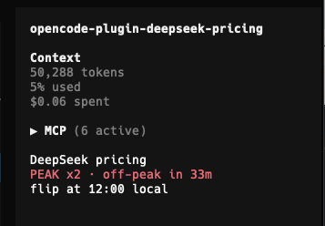

# opencode-plugin-deepseek-peak

An [OpenCode](https://opencode.ai) TUI plugin that shows a live DeepSeek pricing
indicator in the sidebar: whether you are in peak hours right now, when the
state flips, and a warning when the holiday calendar is missing.



## What it shows

```
DeepSeek pricing
OFF-PEAK -50% · peak in 2h 14m
flip at 09:00 local
```

- `PEAK x2` (red) during peak hours, `OFF-PEAK -50%` (green) otherwise
- Countdown to the next flip and the flip time in your local timezone
- `no CN holiday data for this year` when the year is missing from the calendar

## Pricing model

DeepSeek peak hours are 01:00-04:00 and 06:00-10:00 UTC, Monday through Friday,
excluding Chinese public holidays. Every other hour, including weekends and
Chinese public holidays in full, is off-peak at half price.

Source: https://api-docs.deepseek.com/quick_start/pricing/

## Install

Add the published package to `plugins` in `opencode.jsonc`:

```jsonc
// ~/.config/opencode/opencode.jsonc
{
  "$schema": "https://opencode.ai/config.json",
  "plugins": ["opencode-plugin-deepseek-peak"]
}
```

When the TUI connects to a remote server, list the package in `cli.json` too.

Alternative, from a local checkout:

```sh
git clone https://github.com/Zorato/opencode-plugin-deepseek-peak
cd opencode-plugin-deepseek-peak
npm install   # installs the plugin dependency and peer dependencies
```

```jsonc
{
  "$schema": "https://opencode.ai/config.json",
  "plugins": ["/absolute/path/to/opencode-plugin-deepseek-peak"]
}
```

Point the path at the **directory**. OpenCode accepts single `.ts` plugin files,
but a `.tsx` entry that renders JSX has to be a package: a file path fails with
`configured plugin path must be a directory`.

Reload the config after changing the plugin list. If the plugin does not appear,
restart OpenCode: plugins resolve at startup.


## Updating the holiday calendar

The State Council publishes the next year's Chinese public holiday calendar
around November. When it does, add the rest-day ranges to `CN_HOLIDAYS` in
`tui.tsx`:

```ts
const CN_HOLIDAYS: Record<number, ReadonlyArray<readonly [string, string]>> = {
  2027: [
    ["2027-01-01", "2027-01-03"],
    // ...
  ],
}
```

Until a year is added, the plugin treats that year as having no holidays and
marks the sidebar with a warning.

## How it works

- Computes peak state from the UTC clock: peak windows 01:00-04:00 and
  06:00-10:00 UTC, Monday through Friday, minus Chinese public holidays.
- Refreshes every 30 seconds and shows the countdown to the next flip.
- Reads no credentials, sends no requests, stores nothing.

## Plugin package layout

The package follows the OpenCode v2 CLI plugin contract:

```jsonc
{
  "exports": {
    ".": "./index.ts",
    "./tui": "./tui.tsx"
  },
  "dependencies": {
    "@opencode/plugin": "latest"
  },
  "peerDependencies": {
    "@opentui/core": ">=0.6.6",
    "@opentui/solid": ">=0.6.6",
    "solid-js": ">=1.9.0"
  }
}
```

- `"."` is the server entry. It must export `{ id, setup }`. Keep it free of
  TUI imports: loading `@opentui/solid` outside the renderer fails with
  `OPENTUI_FORCE_WCWIDTH is already registered`.
- `"./tui"` is the TUI entry, built with `Plugin.define` from
  `@opencode/plugin/tui`.

## Troubleshooting

| Symptom | Cause |
| --- | --- |
| Nothing rendered | The sidebar is hidden, or you are not inside a session. Sidebar slots only exist within a session. |
| Plugin does not load | Check `/plugins` in the TUI. The configured path must be a directory containing `package.json`. |
| `no CN holiday data for this year` | Add the year's rest days to `CN_HOLIDAYS` in `tui.tsx` (see above). |


## License

[MIT](LICENSE)
